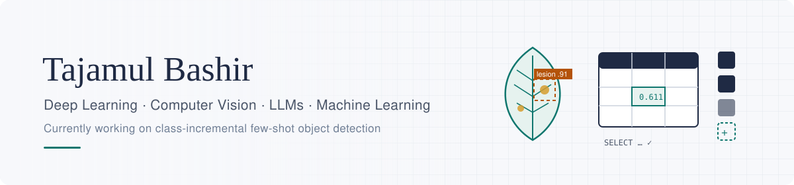

  

  <a href="https://www.linkedin.com/in/tajammulbasheer/">LinkedIn</a> ·
  <a href="mailto:tajammulbasheer.one@gmail.com">tajammulbasheer.one@gmail.com</a> ·
  <a href="Tajamul_Bashir_CV.pdf">CV (PDF)</a>

### Research interests

I am interested in deep learning and AI broadly, especially computer vision and large language models.
The questions I keep coming back to are how models learn from limited or imperfect data, how well they hold
up outside the data they were trained on, and how to make them reliable enough to use in practice.

### Master's research

**Class-incremental few-shot object detection for medical imaging** · IIT Jammu, 2025–2027 
In many real-world settings, some categories have plenty of labelled data while new ones appear later with only a
few examples. My thesis develops object detectors that learn new classes from a handful of images, without retraining
on earlier data and without forgetting the classes they already know. Work in progress; paper in preparation.

### Selected projects

**Plant Disease Recognition: Lab-to-Field Generalization** 
A classifier that scores 99.9% on PlantVillage lab photos gets 18.6% on real field photos from PlantDoc.
The project measures that gap and tests few-shot, semi-supervised and class-incremental training, plus
weakly supervised lesion localization. 
*PyTorch · EfficientNet · U-Net · Grad-CAM* — [Code](https://github.com/tajammulbasheer/plant_leaf_diseases_detection)

**Reproducing and Extending Table-LLM-Specialist (EMNLP 2025)** 
Reproduced the paper's self-trained NL-to-SQL results on Llama-3.1-8B using public GitTables data in place of its
unreleased corpus; the Instruct model matched the paper (0.611 against 0.598). Extended the method with Repair-TS,
which repairs the training pairs the paper's validator discards using execution feedback: +0.042 on base NL-to-SQL,
with gains on NL-to-Scala and NL-to-R. 
*Llama-3.1-8B · QLoRA · DPO · vLLM* — [Code](https://github.com/tajammulbasheer/table_specialist) ·
[Report](https://github.com/tajammulbasheer/table_specialist/blob/main/report/main.pdf) ·
[Slides](https://github.com/tajammulbasheer/table_specialist/blob/main/presentation/endsem.pdf)

### Currently

- Rebuilding a sign language recognition project (image and video)

### Education

**M.Tech, Computer Science and Engineering** — IIT Jammu, 2025–2027 
**B.E., Computer Engineering** — GCET Jammu, 2020–2024

### Skills

Python, C++, C · PyTorch, TensorFlow/Keras, scikit-learn, OpenCV, NumPy, pandas · Hugging Face, vLLM ·
Git, Linux, Docker, LaTeX

  
  

